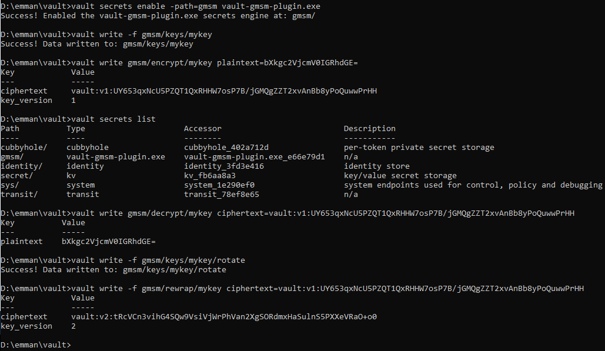
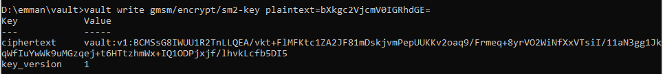
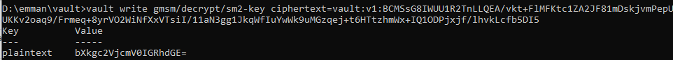
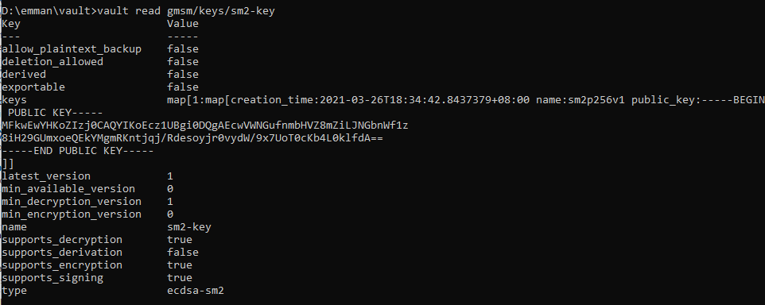
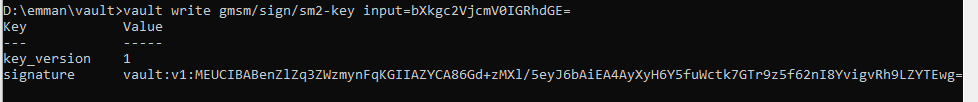
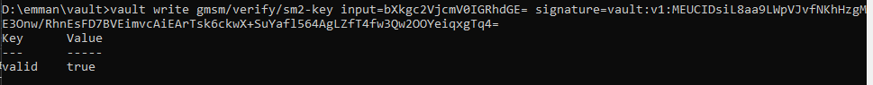

# Vault plugin: GMSM

 
 

1. **sm4_gcm96** is supported now, SM4-GCM with a 128-bit SM4 key and a 96-bit nonce; supports encryption, decryption, key derivation, and convergent encryption.
2. **ecdsa-sm2** is also supported, this key type can be used for encryption/decryption, sign/verify.

#### Run development mode on windows

1. Build the plugin, open command window and go to vault-gmsm-plugin/scripts folder, run build.bat
2. Copy vault-gmsm-plugin.exe to your vault plugin folder
3. Start the vault `vault server -dev -dev-root-token-id=root -dev-plugin-dir=./plugins`
   > **Vault 2.x**: start with an **empty** plugin folder and copy the plugin in only after the server is up, i.e. swap
   > steps 2 and 3. Vault 2.x dev mode probes every binary in `-dev-plugin-dir` at startup and aborts when it is not a
   > database plugin (`Error enabling plugin ...: failed to load plugin as database v5: ... Failed to read any lines from
   > plugin's stdout`). Older Vault builds without that check still accept the original order, and the register/enable
   > steps below are the same either way.
4. Set environment variables: 
   - set VAULT_ADDR=http://127.0.0.1:8200 
   - set VAULT_TOKEN=root
5. Register the plugin `vault plugin register -sha256=0cc95756eda21c9f5d5a2aa272804a68eaa343ef5a6ad5463b3ed423f52eadcf secret vault-gmsm-plugin.exe`，这里的hash值来自plugin.sha256sum   
6. Enable the plugin `vault secrets enable -path=gmsm vault-gmsm-plugin.exe`
7. Create one test key `vault write -f gmsm/keys/mykey`
8. Use the key to encrypt `vault write gmsm/encrypt/mykey plaintext=bXkgc2VjcmV0IGRhdGE=`
9. Use the key to decrypt `vault write gmsm/decrypt/mykey ciphertext=vault:v1:UY653qxNcU5PZQT1QxRHHW7osP7B/jGMQgZZT2xvAnBb8yPoQuwwPrHH`
10. Rotate, `vault write -f gmsm/keys/mykey/rotate`
11. Rewrap, `vault write -f gmsm/rewrap/mykey ciphertext=vault:v1:UY653qxNcU5PZQT1QxRHHW7osP7B/jGMQgZZT2xvAnBb8yPoQuwwPrHH`

#### **ecdsa-sm2**

- Create key: `vault write -f gmsm/keys/sm2-key type=ecdsa-sm2`  
  `Success! Data written to: gmsm/keys/sm2-key`   
- Encryption: 
- Decryption: 
- Read key:     

- Sign:           

- Verify:         

## License

This plugin is distributed under the MIT license; see [LICENSE](LICENSE).

The shape of its request and response fields follows the transit secrets engine
of HashiCorp Vault, which was published under MPL-2.0 up to release 1.14.0. The
parts of `gmsm/` that originate from those releases are therefore also available
under the MPL-2.0. Releases 1.15.0 and later of that repository are licensed
under BUSL-1.1 and are deliberately not used as a source here.
